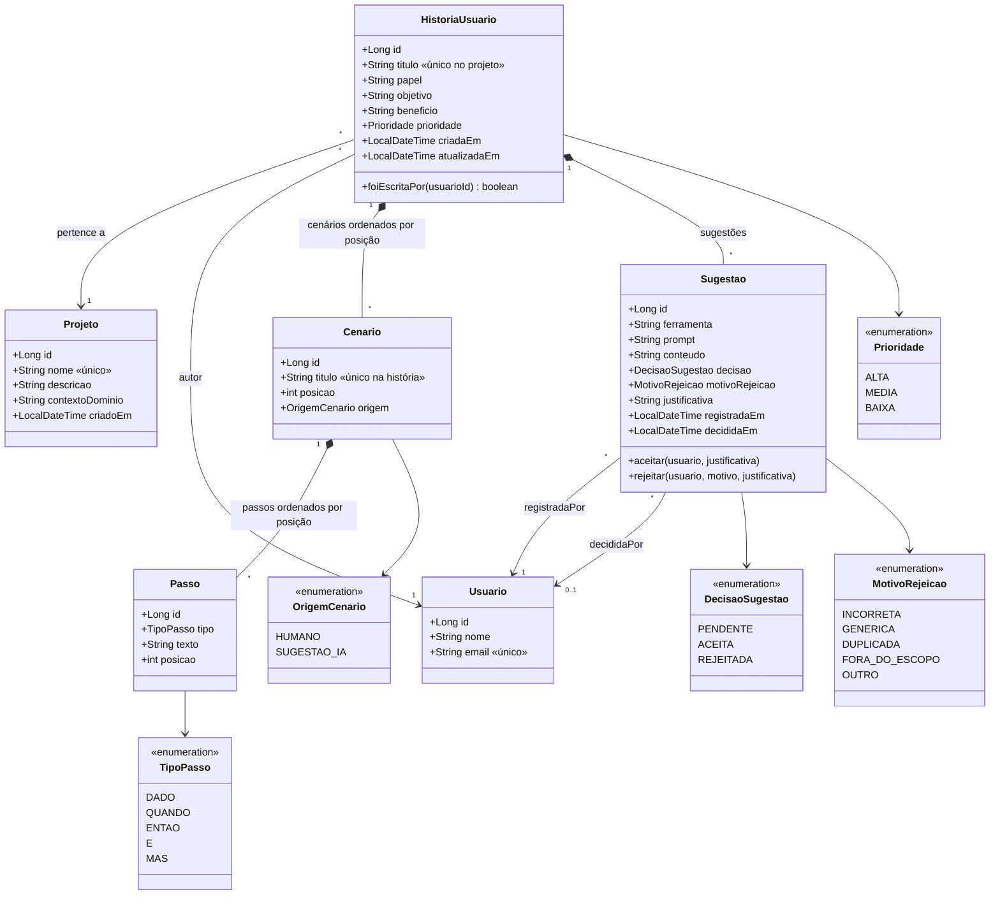
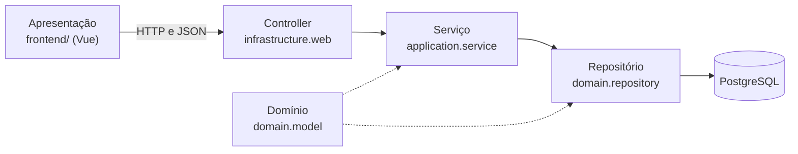

# Diagrama de classes

Modelo de domínio (`domain.model`). As associações e a multiplicidade seguem o mapeamento JPA.

## Notas

- O losango cheio (`*--`) indica composição: cenários, passos e sugestões são removidos junto com a história, e os
  passos junto com o cenário (`cascade` e `orphanRemoval`).
- `Projeto` não guarda a lista de histórias: a associação é unidirecional, da história para o projeto.
- Os passos e os cenários voltam sempre ordenados por `posicao` (`@OrderBy`).
- `motivoRejeicao`, `decididaPor` e `decididaEm` só são preenchidos quando a sugestão deixa de ser `PENDENTE`.
- Restrições de unicidade no banco: e-mail do usuário, nome do projeto, `(projeto, título)` na história e
  `(história, título)` no cenário.

## Camadas

