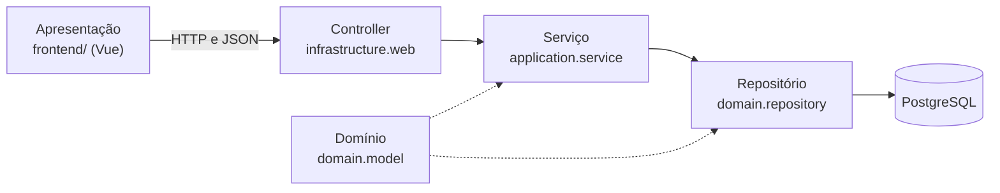

# Estúdio BDD

Aplicação para documentar os requisitos de um sistema. O analista cadastra **histórias de usuário** com seus
**cenários BDD** (Dado/Quando/Então), registra as **sugestões** obtidas com ferramentas de IA, decide se aceita ou
rejeita cada uma e exporta as histórias como arquivos `.feature` (Gherkin em português).

Projeto da disciplina Programação de Sistemas II, 2026/2.

## Integrantes

- _<João Pedro Pizarro Buldrini>_ — _<10437056>_

## Tecnologias

| Parte | Tecnologia |
|---|---|
| API | Java 21, Spring Boot 4, Spring Web, Spring Data JPA, Bean Validation, Lombok |
| Banco | PostgreSQL 16, em contêiner Docker |
| SPA | Vue 3 com Vite (JavaScript) e Vue Router |
| Testes | JUnit 5, Mockito, AssertJ e ArchUnit |

## Como executar

Pré-requisitos: Java 21, Docker e Node.js ^20.19 ou >=22.12. Nenhuma variável de ambiente é necessária.

1. **Banco** (a partir da raiz do projeto):
   ```
   docker compose -f docker/docker-compose.yml up -d
   ```
   PostgreSQL em `localhost:5434`, banco `estudio_bdd`, usuário e senha `estudio`. Essas credenciais são **locais e
   fictícias**, só para o contêiner de desenvolvimento. O volume `pgdata` mantém os dados entre as execuções.
2. **API**:
   ```
   ./mvnw spring-boot:run
   ```
   (no Windows, `mvnw.cmd spring-boot:run`). Sobe em `http://localhost:8080`. Na primeira execução cria as tabelas e
   carrega os dados fictícios; nas seguintes não duplica nada.
3. **SPA**:
   ```
   cd frontend
   npm install
   npm run dev
   ```
   Abre em `http://localhost:5173`. A porta é fixa, porque o CORS da API só libera essa origem.
4. **Testes**: `./mvnw test`. O banco precisa estar de pé, por causa do `contextLoads`. Resultado esperado: 61 testes,
   nenhuma falha.

### Dados fictícios

Carregados por `DadosIniciais` na primeira subida: os usuários **Ana Souza** (`ana@exemplo.com`) e **Bruno Lima**
(`bruno@exemplo.com`), o projeto **Biblioteca Universitária** e as histórias **Reservar livro** (com 2 cenários) e
**Renovar empréstimo** (com 1 cenário). Todas as histórias do seed são da Ana.

Para voltar ao estado inicial, apagando tudo: `docker compose -f docker/docker-compose.yml down -v` e depois `up -d`.

## Arquitetura

O projeto usa Clean Architecture, mapeada para as cinco camadas pedidas no enunciado:

| Camada do enunciado | Onde fica |
|---|---|
| Apresentação (SPA) | `frontend/` |
| Controller (API REST) | `infrastructure.web` (controllers, DTOs e `ApiExceptionHandler`) |
| Serviço | `application.service` e `application.exception` |
| Repositório | `domain.repository` |
| Domínio | `domain.model` (entidades JPA e enums) |

`infrastructure.config` guarda o CORS e a carga de dados.



Três regras de dependência são verificadas pelo ArchUnit (`ArquiteturaTest`) em todo `mvn test`:

- `domain` não depende de `application` nem de `infrastructure`;
- `application` não depende de `infrastructure`;
- `infrastructure.web` (os controllers) não acessa `domain.repository`.

**Decisão de projeto:** as entidades JPA servem como modelo de domínio, em vez de separar "domínio puro" e "entidade
de persistência" com mapeadores. A separação total dobraria o código sem benefício para este escopo. O domínio fica
acoplado ao JPA, mas isolado da web, e isso é verificado pelo ArchUnit.

**Carregamento das associações:** todas as associações são `LAZY` e o `open-in-view` está desligado. As leituras que
alimentam DTOs usam `@EntityGraph` para trazer o que a resposta precisa em uma consulta só. Coleções `List`
aninhadas não são carregadas juntas (daria `MultipleBagFetchException`): cenários e passos vêm de
`CenarioRepository`.

**Transações:** `@Transactional` só nos métodos que escrevem (criar, atualizar, excluir, aceitar, rejeitar). O
`atualizar` depende dela, porque a gravação acontece por dirty checking ao fim da transação.

## Regras de negócio e onde ficam

| Regra | Implementação | Teste |
|---|---|---|
| 1. Unicidade e campos obrigatórios | `ProjetoService`, `HistoriaService`, `CenarioService`, Bean Validation nos DTOs e restrições `unique` no banco | `ProjetoServiceTest`, `HistoriaServiceTest` |
| 2. Formato do cenário | `ValidadorPassos` (ordem, E/Mas, Quando e Então obrigatórios) | `ValidadorPassosTest` (inclui o cenário sem Então) |
| 3. Autoria | `HistoriaUsuario.foiEscritaPor`, `HistoriaService.buscarComoAutor`, `CenarioService` | `HistoriaServiceTest`, `CenarioServiceTest` |
| 4. Sugestões | `SugestaoService`, `Sugestao.aceitar` e `Sugestao.rejeitar` | `SugestaoServiceTest` (inclui a rejeição sem motivo) |
| 5. Exportação | `ExportacaoService` e `GeradorFeature` | `ExportacaoServiceTest` (inclui o bloqueio com sugestão pendente), `GeradorFeatureTest` |
| 6. Consulta do projeto | `ConsultaProjetoService.consultar` | `ConsultaProjetoServiceTest` |
| 7. Resumo do projeto | `ConsultaProjetoService.resumir` | `ConsultaProjetoServiceTest` |

## API

Todos os endpoints, os códigos de resposta e o formato de erro estão em [`docs/API.md`](docs/API.md). Os roteiros
`.http` usados na verificação estão em `requests/` (abrem no cliente HTTP do IntelliJ).

### Identidade simulada (limitação)

O usuário atual é enviado no cabeçalho `X-Usuario-Id`. **Isso não é autenticação:** não há senha nem token, e qualquer
cliente pode enviar o id de outro usuário. O cabeçalho só serve para registrar a autoria e aplicar a regra "somente o
autor edita ou exclui a história e seus cenários". Autenticação real (Spring Security) está fora do escopo.

### CORS

Liberado só para a origem da SPA, `http://localhost:5173`, e só para `/api/**`. Uma origem diferente recebe 403.

## Decisões que adaptam o modelo sugerido

- **`Projeto` não guarda a lista de histórias.** A associação é unidirecional: a história aponta para o projeto.
- **Os passos são editados pelo cenário.** O `PUT` de um cenário substitui a sequência inteira de passos, porque a
  regra 2 só faz sentido sobre a sequência completa. Não há endpoints para criar ou apagar um passo isolado.
- **A posição é do servidor.** O cliente manda os passos em ordem e a API numera de 1 a n; um cenário novo ganha a
  posição seguinte à maior existente.
- **Sugestões não têm `PUT` nem `DELETE`.** Elas nascem pendentes e, depois de decididas, ficam imutáveis (409). Aceitar
  não altera os cenários: o analista os ajusta e marca a origem `SUGESTAO_IA`.
- **Qualquer usuário identificado pode registrar e decidir sugestões.** A regra de autoria vale para a história e os
  cenários, e o modelo guarda `registradaPor` e `decididaPor` separados.
- **O motivo `OUTRO` exige justificativa.** Regra acrescentada por mim: um motivo sem explicação não informa nada.
- **Excluir uma história remove seus cenários, passos e sugestões** (`CascadeType.REMOVE` e `orphanRemoval`).
- **Códigos de erro:** 422 quando o pedido é válido mas fere uma regra de negócio; 409 quando conflita com o estado
  atual (título repetido, sugestão já decidida, exportação bloqueada).
- **A exportação usa tags opcionais:** `@prioridade-alta|media|baixa` na funcionalidade e `@sugestao-ia` nos cenários
  de origem `SUGESTAO_IA`.
- **Endpoints extras:** `GET /api/usuarios` (alimenta a seleção de usuário da SPA) e
  `GET /api/projetos/{id}/consulta` (histórias com as contagens da regra 6).


## Uso de IA no desenvolvimento

Usei o Claude como ferramenta de desenvolvimento. O registro das interações está em
[`docs/REGISTRO_IA.md`](docs/REGISTRO_IA.md), e as regras e convenções que a IA deve seguir estão em
[`AGENTS.md`](AGENTS.md).

## Entregáveis

| Item do enunciado | Onde está |
|---|---|
| README com integrantes e instruções | este arquivo |
| Dados fictícios | `DadosIniciais` (seção "Dados fictícios") |
| Diagrama de classes | [`docs/DIAGRAMA_CLASSES.md`](docs/DIAGRAMA_CLASSES.md) |
| Documentação dos endpoints | [`docs/API.md`](docs/API.md) |
| Arquivo `.feature` exportado pelo sistema | [`docs/exemplo-reservar-livro.feature`](docs/exemplo-reservar-livro.feature) |
| Registro de IA | [`docs/REGISTRO_IA.md`](docs/REGISTRO_IA.md) |
| Roteiro e evidências de verificação | [`docs/ROTEIRO_VERIFICACAO.md`](docs/ROTEIRO_VERIFICACAO.md) e `docs/evidencias/` |
| Atividade bônus | não implementada |

## Estrutura do repositório

```
.
├── docker/docker-compose.yml
├── docs/                  API.md, diagrama, roteiro, registro de IA, .feature de exemplo e evidências
├── frontend/              SPA (Vue 3 + Vite)
├── requests/              roteiros .http de verificação da API
├── src/main/java/dev/jppb/bddestudio/
│   ├── domain/            model (entidades e enums) e repository
│   ├── application/       service e exception
│   └── infrastructure/    web (controllers e DTOs) e config
├── src/test/java/         testes de regras, de serviço e de arquitetura
├── AGENTS.md
└── README.md
```